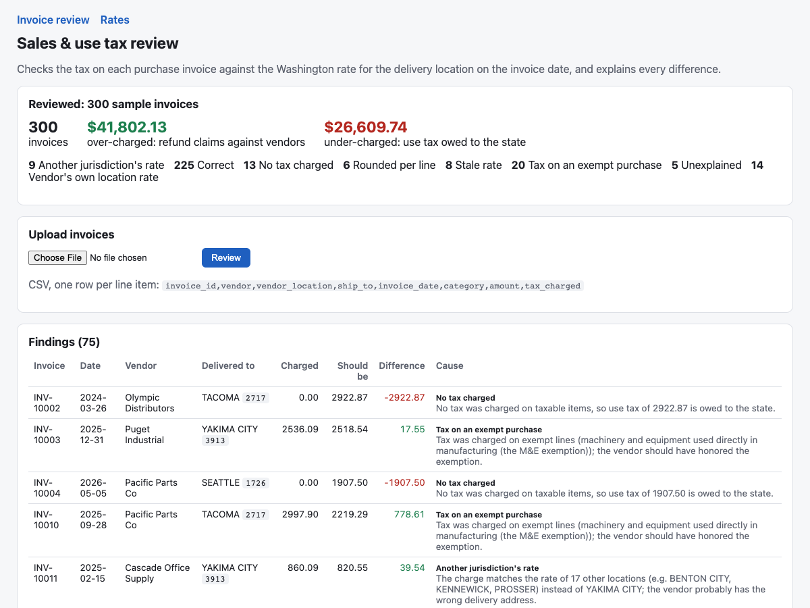

# taxcheck: Sales & Use Tax Review for Purchase Invoices

A company that buys goods in Washington owes sales tax at the rate of the place the goods are **delivered**, on the
date of the sale. Vendors get this wrong in predictable ways, and every mistake costs the buyer:
- **Over-charged tax** is money the buyer can claim back. Finding it is the "reverse audit" that tax firms do for
  large companies.
- **Under-charged tax** is use tax the buyer still owes the state, and an audit finding if it isn't paid.

taxcheck is a Java web application that does this review:
- **Rates:** loads three years of real Washington sales tax rates.
- **The check:** computes what each invoice should have charged.
- **The diagnosis:** for every difference, works out *why*: which mistake reproduces the charged amount to the
  cent.

Spring Boot (Spring MVC + Thymeleaf), JDBC with plain SQL on an embedded relational database (H2), and JUnit tests.



## Data

The Washington State Department of Revenue's quarterly rate files, **Q1 2024 through Q4 2026**, bundled in
`src/main/resources/rates/`. Each file has one row per location code, with state, local and transit (RTA) rates.
That covers about 400 locations and **416 rate changes at 266 of them** in three years, which is why vendors so
often charge a stale rate. Consecutive quarters with the same rate are merged into one period per location.

### A bug in the source data

Location codes are four digits, and those starting with 0 cover whole counties (Adams County is `0100`). In **two
of the twelve files (Q1 2025 and Q3 2026), all 54 of those codes lost their leading zero**: Adams County appears as
`100`. Read as-is:
- the data shows 464 locations instead of 410;
- those 54 locations have two-quarter holes in their history, and **21 real rate changes disappear**;
- an invoice delivered to any of them in either quarter is reported as an unknown location.

The fix pads codes back to four digits when loading, and when reading uploaded invoices too, since spreadsheets
strip the zero the same way. Four tests fail without it.

## The review

For each invoice:
- **Expected tax:** the delivery location's combined rate on the invoice date, applied to the taxable lines and
  rounded once to the cent.
- **Diagnosis:** each known mistake is tested to see whether it reproduces the charged amount within a cent.

| Cause | What the vendor did | Consequence |
|---|---|---|
| Stale rate | used the location's previous rate after a change (within 120 days) | either way |
| Vendor's own location rate | charged its own local rate; Washington tax follows the delivery location | either way |
| Another jurisdiction's rate | matches some other location's rate: likely the wrong delivery address on file | either way |
| Tax on an exempt purchase | taxed resale inventory or manufacturing equipment (M&E exemption) | refund claim |
| No tax charged | charged nothing on taxable items | use tax owed |
| Rounded per line | rounded each line instead of the total; off by a cent or two | immaterial |
| Unexplained | no single mistake fits | review by hand |

When more than one cause fits, the most common one is reported and the others are listed. The answer is never
forced: two mistakes on one invoice come back as **unexplained**, for a person to look at.

## Evaluation

There is no public set of real vendor invoices, so `--eval` builds **3,000 synthetic invoices** for a manufacturer
with eight Washington facilities. They are priced with the real rate history and carry planted mistakes:
- each of the causes above;
- vendors whose systems round line by line;
- wrong delivery addresses;
- two mistakes on one invoice.

The diagnosis is then scored against what was planted (`results/review-eval.json`):

| | |
|---|---|
| Invoices with a material error | 687 of 3,000 |
| Flagged | 686 |
| Root cause named correctly | **679 (98.8%)** |
| False flags on correct invoices | 0 of 2,313 |
| Over-charged (refund opportunity) | $375,728 |
| Under-charged (use tax owed) | $223,890 |

**The misses are the instructive part:**
- **7 can't be told apart from the invoice alone.** A wrong delivery address happened to carry the same rate as
  the vendor's own location, so the reviewer reports the more common cause, "vendor's own rate."
- **1 is immaterial.** The wrong jurisdiction's rate was so close to the right one that the difference rounded to
  a cent.

**Read these numbers for what they are.** The generator and the reviewer share a model of how vendors go wrong, so
this shows that the diagnosis logic is implemented correctly and handles rounding and overlapping explanations. It
is not a measure of accuracy on real invoices; that would need real audit data.

## Run it

```bash
mvn spring-boot:run                                    # http://localhost:8080
mvn spring-boot:run -Dspring-boot.run.arguments=--eval # the evaluation above
mvn verify                                             # 14 tests
```

- **Pages:** `/` (review the sample, or upload your own CSV), `/rates?q=seattle` (search), `/rates/1726` (a
  location's rate history).
- **REST:**
  - `GET /api/rates/{code}?date=2026-01-01` returns the rate in force;
  - `POST /api/review` with a `text/csv` body returns one result per invoice: expected tax, difference, cause and
    explanation.

Invoice CSV, one row per line item:

```text
invoice_id,vendor,vendor_location,ship_to,invoice_date,category,amount,tax_charged
A1,Acme,3210,1726,2026-01-20,OFFICE_SUPPLIES,1000.00,103.50
```

That invoice comes back as *stale rate*: "The vendor used 10.35%, the rate before 2026-01-01, 19 days after it
changed to 10.55%" (Seattle's rate rose on January 1, 2026).

## Design notes

- **Money is `BigDecimal`, never floating point,** and rounding is explicit (half up, once per invoice).
- **The database checks the data, not just the code:** each period's state, local and transit rates must add up to
  its combined rate, and periods can't run backwards.
- **Uploads are validated line by line.** Errors name the line and the problem (a date not in YYYY-MM-DD, an
  unknown category, an invoice whose header fields differ between its lines), and size is capped.
- **The app listens on localhost by default.**

## Tests

`mvn verify`: 14 tests.
- **Loader:** code padding, a byte-order mark, quoted names, merging quarters and splitting on changes and gaps.
- **Rates, on the real data:** rate boundaries on the first day of a quarter.
- **The reviewer:** each cause on hand-built invoices, two mistakes at once left unexplained, and the planted-error
  check.
- **The web layer, through MockMvc:** the REST API's error messages and every page.

## Limitations

- **Taxability is simplified** to five categories. Real determinations depend on facts and documents
  (exemption certificates, how equipment is used), and Washington's taxable services changed in October 2025. This
  is a demonstration, not tax advice.
- **Washington only, and Q1 2024 to Q4 2026.** A location's rate depends on its code; a real system would also
  geocode delivery addresses to codes, which the Department of Revenue's address files support.
- **The invoices are synthetic** (see Evaluation).

Built with AI assistance (Claude Code). I reviewed the code; the tests and the evaluation are how I checked it, and
the leading-zero bug came from checking the data, not from a test.
